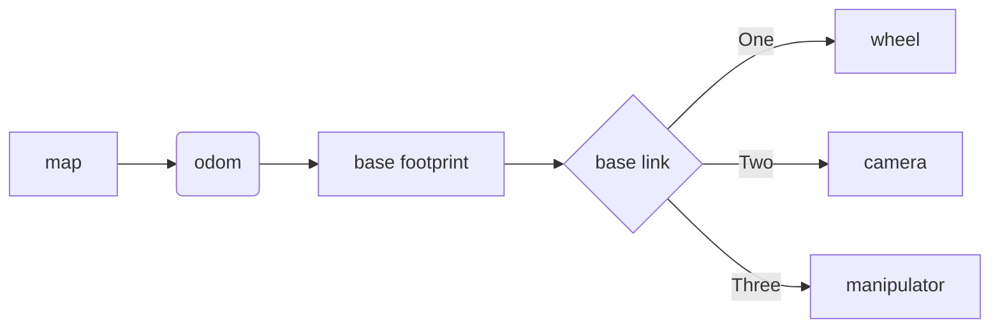

# 2026-10-13 TIL — SLAM 좌표계 구조와 오도메트리·EKF

---

## 1. 지도제작(mapping) 방식 두 가지

- **cuVSLAM**: CUDA(GPU)를 활용하는 방식.
- **Cartographer**: CPU만 사용하며 submap을 쌓아가는 구조라 상대적으로 무겁다.

이 둘의 차이가 연산 자원을 어디에 싣느냐(GPU vs CPU)의 문제이고, 그래서 SBC와 엣지 컴퓨터를 나눠 역할을 분담한다는 맥락으로 이어졌다.

## 2. 오도메트리와 오차

- **오도메트리**는 로봇이 스스로 예상하는 자신의 위치다.
- 센서값 중에서는 **각속도**의 오차가 가장 크고, 이를 추정하는 방법은 여러 가지가 있다.
- 소수점 8자리까지 정밀하게 다뤄도 오차는 여전히 발생한다.
- **EKF(확장 칼만 필터)**: 로봇이 물리적으로 어떻게 움직이는지를 모델로 삼아, 여러 센서값을 함께 쓰면 더 정확해진다. 다만 센서를 너무 많이 넣는 것도 좋지 않다.

## 3. SLAM 좌표계(TF) 구조

최상위부터 내려오는 순서는 map → odom → base_footprint 이고, odom이 base_footprint보다 먼저 온다. SLAM은 오도메트리를 쓰기 때문에 이 순서가 중요하다.

## 4. loop closure

- 용어만 접하고 내용은 아직 채우지 못했다. 다음에 정리할 주제로 남겨둔다.
